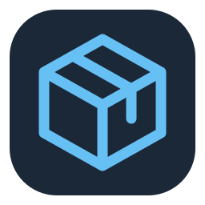
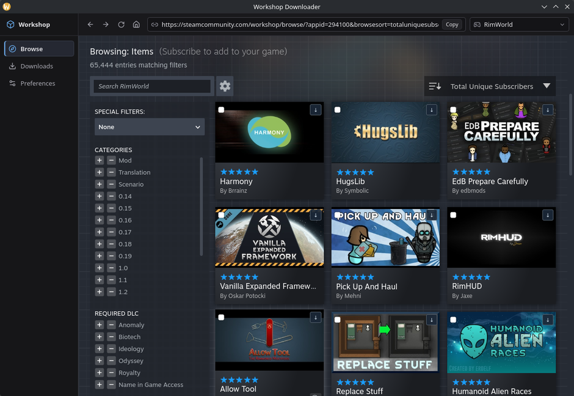

# Workshop Downloader



Workshop Downloader is a desktop Steam Workshop browser and downloader for individual items, selections, and collections. It uses a native webview for Steam and writes downloaded files to folders you choose. Installation and activation of mods are handled by the game or your mod manager.



## Install

Get the latest build from [GitHub Releases](https://github.com/NotYetFound/Workshop-Downloader/releases). Compare its SHA-256 digest with `SHA256SUMS.txt` on the release page.

| Platform | Package | Installation |
| --- | --- | --- |
| Windows 10 (1809+) and Windows 11, x86-64 | `*-setup.exe` | Run the per-user installer. It can download the WebView2 runtime if needed. |
| Linux, x86-64 | `.AppImage` | Mark it executable in your file manager or with `chmod +x <file>.AppImage`, then open it. |
| Fedora and Nobara, x86-64 | `.rpm` | Run `sudo dnf install ./<file>.rpm`, then open Workshop Downloader from the app menu. |

Linux downloading requires [Landlock ABI 3 or later](https://docs.kernel.org/userspace-api/landlock.html). SteamCMD on x86-64 Linux can also require 32-bit system libraries. The AppImage includes GStreamer media plugins. Check the release notes for platform verification and known limitations.

## First run and download engines

1. Confirm the default download folder, `Downloads/SteamWorkshop`.
2. Check for a working engine or select **Set up** to install one from its official source. One engine is enough. You can open the Workshop and finish setting up downloads later.
3. Open **Preferences → Download engines** to select a manual executable, check versions, update a managed installation, or restore its previous version. Save preferences after changing paths or defaults.

The official tools are [Valve SteamCMD](https://developer.valvesoftware.com/wiki/SteamCMD) and [SteamRE DepotDownloader](https://github.com/SteamRE/DepotDownloader/releases/latest). Managed setup downloads them separately. For a manual SteamCMD installation, choose the official `steamcmd.sh` next to its Linux binaries or `steamcmd.exe` on Windows. For DepotDownloader, choose its standalone executable for your OS. DepotDownloader is [GPL-2.0 licensed](https://github.com/SteamRE/DepotDownloader/blob/DepotDownloader_3.4.0/LICENSE).

**Automatic** prefers an eligible SteamCMD installation, then DepotDownloader. An unavailable executable or unsupported operation can switch to the next eligible provider. Authentication holds the job on the selected engine. Ownership, item, and network errors appear in Downloads.

## Browse and download

1. Open an individual item in **Browse** and left-click **Download…** in the app toolbar to queue it immediately using your saved default backend and sign-in preference.
2. Right-click the same button for a native overlay menu. Toggle **Sign in with Steam** for that menu invocation if needed, then click an engine to queue one download immediately. The next left-click uses your saved defaults. Save your default backend, sign-in preference, and Steam account name in **Preferences → Download engines**. The sidebar shows the current mod, its Workshop size, its position in the batch, and the progress reported by the engine. The counter includes downloads queued behind the current item. A percentage bar appears when the engine reports measurable progress. SteamCMD Workshop transfers can show bytes staged on disk while waiting for the final size. Failures appear in a separate dismissible alert. Press Enter in the address bar to navigate; **Copy** copies the current page URL.
3. Use **Downloads** to cancel an active or queued job, retry, open the folder, expand the log, or remove a terminal job from history. Removing history keeps installed files and their Downloaded badge.
4. **Download again…** creates another copy. Explicit replacement remains available when retrying a replacement job; batches never replace existing folders.

### Steam sign-in

Public items can download anonymously. When an engine asks for sign-in, a separate window guides you through the account name, password, Steam Guard code, or mobile approval that the engine requests. Enable **Use Steam mobile QR when signing in with DepotDownloader** in Preferences to scan a QR challenge when signing in with that engine. Authentication input goes to the private backend terminal. Debug and exported diagnostics exclude authentication data.

Change the account name in Preferences to switch accounts. **Clear session** is available for SteamCMD and Linux DepotDownloader. Windows DepotDownloader uses the .NET account store, where Steam's account security controls can revoke the session. A signed-in job still queued after restart can be resumed with the appropriate sign-in settings.

## Collections, selections, and batches

Open a collection’s normal Workshop URL and choose **Download Collection…**. The trusted app preview lists the collection name, game, all unique leaf items, current downloaded states, and unavailable members. Select All / Deselect All act only on eligible items. Downloaded and externally detected items are excluded by default; **Include downloaded items** explicitly permits selecting them again. A native menu engine action on a collection opens this required preview with that engine chosen for this operation.

On supported Steam browse/search cards, use the selection checkbox or compact download arrow. **Download Selected** appears only while items are selected. Multiple selections open a preview with **Download Selected**. Single items show a compact **Download** action in the app while the Steam page stays visible. Back dismisses either view and keeps the current Workshop page. They do not silently execute native commands. Steam search, sorting, filtering, subscriptions, and navigation continue normally.

**Downloads** groups jobs into expandable batches with completed, failed, skipped, and cancelled counts. Cancel remaining jobs or retry failed/cancelled jobs and resume account jobs using saved preferences. Each job retains its own log, retry action, and destination-folder action. Batch members’ histories are retained with the batch rather than individually removable. Progress counts completed items and never estimates aggregate byte percentages.

Collection metadata uses [Valve’s GetCollectionDetails and GetPublishedFileDetails endpoints](https://partner.steamgames.com/doc/webapi/ISteamRemoteStorage). The public metadata endpoint can omit file type, so the collection endpoint supplies the authoritative collection check. Nested traversal removes duplicates and detects repeated/cyclic collections. Limits are 2,000 unique items, 128 collections, and 16 nesting levels. Requests run serially in chunks of at most 50 IDs, with a minimum delay and bounded response size. Private/deleted items appear as unavailable; cross-game members cannot enter a collection batch. Queue admission rechecks public metadata and commits jobs and membership together.

## Recognize existing content

In **Preferences → Existing downloads**, choose a directory and scan. Steam/SteamCMD discovery reads `appworkshop_<appid>.acf` and its installed entries, then verifies the corresponding `content/<appid>/<publishedfileid>` tree. Choose a Steam installation to scan Workshop folders listed in `libraryfolders.vdf`, or select the Workshop directory containing its ACF files. Workshop Downloader inventory files are also recognized when present in copied exports.

For DepotDownloader output containing `.DepotDownloader/<appid>_<manifest>.manifest`, supply the matching Workshop item URL. Valve’s published-file metadata must match both the game and content manifest ID. A manifest alone cannot reliably identify a published-file ID, so the app does not infer one from the folder name. Known manifest byte sizes must match the captured payload. Unidentifiable, unsafe, missing, or incomplete content produces scan notes.

External records retain their source, path, and file inventory separately from app-managed installations. Scanning is read-only: it never adds markers to Steam folders, moves files, or allows external paths to become replacement targets. Repeated scans update the same identity/location record. Size and file inventory verification detects missing files and changed sizes; it does not claim cryptographic verification of every external file. Use a rescan after intentionally modifying external content.

## Destinations and recovery

Preferences default to the operating system’s Downloads folder under `SteamWorkshop`. Game organization uses the saved game’s name, with its App ID added if two normalized game names collide. An unknown game uses a folder such as `App 322330`. A per-game override is used directly as the root. The default mod folder name is the Workshop title. You can also use title plus ID or ID alone. When Valve omits a title, the published-file ID is used.

The worker runs one job at a time in FIFO order among jobs ready to run. On Linux, Landlock restricts downloader writes to the job staging area and the provider’s private runtime. DepotDownloader also gets the narrow system .NET named-mutex directory required by its runtime. On Windows, CLI providers run with the user’s filesystem permissions and a Job Object for process-tree cancellation. Finalization validates and publishes files on both platforms. It requires a backend completion marker, a successful exit, and a nonempty tree matching the byte total when the CLI reports one. The staged files are copied to a private sibling directory, verified, and renamed into place without overwriting an occupied destination. Unsafe names, links, reparse points, and case-insensitive filename conflicts are rejected. A small inventory file inside each completed folder lets the app detect missing or changed-size files after restart.

SQLite schema version 3 stores the queue, histories, bounded logs, current installations, collection metadata/membership, previews, batches and their job relationships, and separate external inventories. Migrations preserve version 1/2 settings and job records. Account passwords and Guard codes are never persisted. Current content states distinguish queued, downloading, downloaded, external, missing, failed, and not downloaded; file inventories are cached for five seconds, invalidated on imports and completion, and rebuilt after restart. An interrupted transfer can be retried. If publication finished before the app exited, recovery can verify the folder and commit its record. A previous folder is restored when a replacement was interrupted before publication. An occupied destination is left intact, and the old backup is kept if it cannot be restored safely.

## Diagnostics and updates

Open **Preferences → Application and diagnostics → Debug** for the live Terminal and Logs tabs. **Export diagnostics** saves app and OS versions, checked engine versions, and recent download status and error categories. The export excludes raw terminal output, paths, item IDs, and account identifiers.

Signed Windows and AppImage builds can check GitHub Releases for app updates. Use the latest RPM for package-managed installs. Builds without an updater key link to GitHub Releases for manual updates.

## Browser and security

The Svelte shell and the native Steam child webview have separate labels and profiles. Windows uses the Tauri WebView2 child. Linux uses a GTK overlay to position the child inside the main window despite [Wayland child-view sizing issues](https://github.com/tauri-apps/tauri/issues/15656). The child is hidden on Downloads, Preferences, and trusted previews while its history is retained. Right-click engine actions use Tauri’s native context menu, which overlays the child without resizing it.

Steam gets no Tauri capability. The Steam page has no always-visible Workshop Downloader toolbar. Compact card controls and an on-demand selection action can request a local confirmation or preview. The trusted shell makes the actual queue request, and Rust resolves the consumer App ID, title, and update time through [Valve’s GetPublishedFileDetails endpoint](https://partner.steamgames.com/doc/webapi/ISteamRemoteStorage#GetPublishedFileDetails). Only Workshop IDs and status labels are sent back to the Steam page. No paths, account information, or logs cross into remote content. Browse-card badges appear beside the rating stars, above the item title; card identification uses canonical Workshop links rather than Steam’s hashed layout classes. Filesystem paths, process execution, and authentication remain in the local shell and Rust backend.

| Module | Responsibility |
| --- | --- |
| `src-tauri/src/downloads/manager.rs` | Queue scheduling, cancellation, retry, authentication state, and recovery |
| `src-tauri/src/downloads/providers.rs` | Provider discovery, selection, structured CLI arguments, and progress/error parsing |
| `src-tauri/src/downloads/process.rs` | Private terminals, process-tree cleanup, and transient prompt input |
| `src-tauri/src/downloads/files.rs` | File verification, atomic publication, replacement, and inventories |
| `src-tauri/src/storage.rs` | Transactional SQLite migrations, batch membership, and records |
| `src-tauri/src/steam.rs` | Authoritative metadata, bounded collection traversal, and URL validation |
| `src-tauri/src/workshop/commands.rs` | Trusted previews, batch admission, and external scan orchestration |
| `src-tauri/src/workshop/external.rs` | Read-only manifest discovery and external file inventories |
| `src-tauri/src/injection/workshop.js` | Workshop item actions and dynamic badges |

## Build and test

Use stable Rust and Node.js 22.12+ or 24+. Install the [Tauri Linux prerequisites](https://v2.tauri.app/start/prerequisites/#linux) or [Windows C++ Build Tools and WebView2](https://v2.tauri.app/start/prerequisites/#windows).

```sh
npm ci
npm run tauri dev
```

```sh
npm run build
cargo fmt --manifest-path src-tauri/Cargo.toml --all --check
cargo clippy --locked --manifest-path src-tauri/Cargo.toml --all-targets -- -D warnings
cargo test --locked --manifest-path src-tauri/Cargo.toml
npm run tauri -- build --no-bundle -- --locked
```

Rust tests regenerate the TypeScript contracts in `src/lib/contracts`. See [release validation](docs/release-validation.md) for packaging, signing, and the desktop smoke checklist, and [release notes](docs/release-notes.md) for current limitations.

## License

[MIT](LICENSE).
